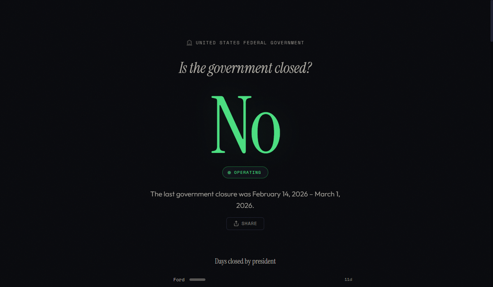

# isthegovernmentclosed

A single-purpose website that answers one question: **Is the US Federal Government closed?**

Live-scrapes public sources (OPM.gov) for real-time federal operating status and maintains a curated record of every government shutdown since 1976. Displays a giant answer with contextual details, a day counter during active shutdowns, presidential stats, and a full historical timeline.

## Modes

The site has three display modes depending on the current federal operating status.

### Open — "No"

Government is operating normally. Green accent, pulsing status dot.



### Full Shutdown — "Yes"

Government is fully shut down. Red accent, urgent pulse, day counter visible.


### Partial Shutdown — "Partially"

One or more agencies have lost funding while others remain open. Amber accent, day counter visible.


## Features

- **Live status** — Scrapes OPM.gov and other public sources for real-time shutdown detection
- **Three display modes** — Full shutdown (red), partial shutdown (amber), open (green)
- **Day counter** — Animated counter showing days closed during active shutdowns
- **Presidential stats** — Bar chart of total shutdown days by president
- **Historical timeline** — Every US federal government shutdown since 1976, with expandable descriptions
- **Auto-refresh** — Re-checks status every 15 minutes
- **Responsive** — Desktop timeline alternates left/right; mobile collapses to single column
- **No build step** — Vanilla HTML/CSS/JS frontend served by Express

## Getting Started

### Prerequisites

- [Node.js](https://nodejs.org/) (v18 or later recommended)

### Install and Run

```bash
git clone https://github.com/captaintestyttv/isthegovernmentclosed.git
cd isthegovernmentclosed
npm install
npm start
```

The site will be available at [http://localhost:3000](http://localhost:3000).

For development with auto-reload:

```bash
npm run dev
```

## API

### `GET /api/status`

Returns the current shutdown status as JSON.

```json
{
  "isClosed": true,
  "type": "partial",
  "message": "The government has been partially closed since February 14, 2026.",
  "since": "2026-02-14",
  "daysClosed": 22,
  "liveCheck": {
    "closed": true,
    "sources": [{ "name": "OPM JSON API" }]
  },
  "lastScraped": "2026-03-08T12:00:00.000Z"
}
```

| Field | Type | Description |
|-------|------|-------------|
| `isClosed` | boolean | Whether the government is currently shut down |
| `type` | string | `"full"` or `"partial"` (only when closed) |
| `message` | string | Human-readable status message |
| `since` | string | Start date of current shutdown (only when closed) |
| `daysClosed` | number | Days since shutdown started (only when closed) |
| `lastClosure` | object | Most recent past shutdown (only when open) |
| `liveCheck` | object | Results from live source scraping |
| `lastScraped` | string | Timestamp of the last scrape |

Scrape results are cached for 15 minutes.

### `GET /api/shutdowns`

Returns the full shutdown history with computed fields.

```json
{
  "shutdowns": [
    { "start": "2018-12-22", "end": "2019-01-25", "type": "full", "days": 35 }
  ],
  "count": 23,
  "totalDays": 195,
  "maxDays": 43
}
```

| Field | Type | Description |
|-------|------|-------------|
| `shutdowns` | array | All shutdowns with start, end, type, and computed days |
| `count` | number | Total number of shutdowns |
| `totalDays` | number | Sum of all shutdown durations |
| `maxDays` | number | Longest shutdown in days (for proportional display) |

## Project Structure

```
isthegovernmentclosed/
├── server.js            # Express server — serves API + static files
├── src/
│   ├── shutdowns.js     # Historical shutdown data + status logic
│   └── scraper.js       # Scrapes OPM.gov and other public sources
├── public/
│   ├── index.html       # Single-page frontend
│   ├── style.css        # Styles (dark theme, responsive)
│   └── app.js           # Client-side rendering (fetches from API)
├── package.json
├── amplify.yml          # AWS Amplify build config
└── README.md
```

## Deploying to AWS Amplify

This app runs as a Node.js server (not a static site), so it requires Amplify's **SSR/Compute** hosting.

### Option 1: Deploy via Amplify Console

1. Go to the [AWS Amplify Console](https://console.aws.amazon.com/amplify/)
2. Click **New app** > **Host web app**
3. Connect your GitHub repository and select the branch to deploy
4. Amplify must detect this as an **SSR** app (not static). Ensure the platform is set to **Web Compute** under **App settings** > **General** > **Platform**
5. The repo includes an `amplify.yml` that handles the build. Set the start command to `npm start` and port to `3000`
6. Click **Save and deploy**

> **Important:** This app requires a running Node.js server. Static hosting will not work — the frontend fetches all data from `/api/status` and `/api/shutdowns` endpoints served by Express.

### Option 2: Deploy via Amplify CLI

```bash
npm install -g @aws-amplify/cli
amplify init
amplify add hosting   # Select: Hosting with Amplify Console
amplify publish
```

### Environment Variables

No environment variables are required. The server defaults to port 3000, which Amplify maps automatically. To override the port, set the `PORT` environment variable in the Amplify Console under **App settings** > **Environment variables**.

### Custom Domain

After deploying, you can add a custom domain in the Amplify Console under **App settings** > **Domain management**. Amplify provisions an SSL certificate automatically.

## Contributing

### Adding a new shutdown

Add an entry to the `SHUTDOWNS` array in `src/shutdowns.js`:

```js
{ start: 'YYYY-MM-DD', end: 'YYYY-MM-DD' }
```

Use `end: null` for an ongoing shutdown. Set `type: 'partial'` for partial shutdowns.

### Adding a new scrape source

Add an entry to the `SOURCES` array in `src/scraper.js` with a `name`, `url`, and `check` function.

## License

MIT
