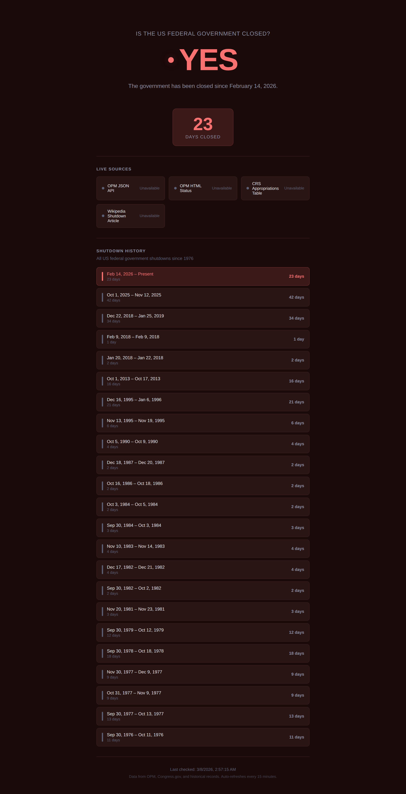

# isthegovernmentclosed

A simple website that answers one question: **Is the US Federal Government closed?**

It scrapes live public sources (like OPM.gov) to determine the current federal operating status and falls back on a curated list of every government shutdown since 1976. The frontend displays a large "Yes" or "No" with contextual details.



## Features

- **Live status** — Scrapes OPM.gov and other public sources for real-time shutdown detection
- **Historical timeline** — Every US federal government shutdown since 1976
- **Day counter** — Shows how many days the government has been closed during an active shutdown
- **Auto-refresh** — Re-checks status every 15 minutes
- **Responsive** — Works on desktop and mobile
- **No build step** — Vanilla HTML/CSS/JS frontend served by Express

## Getting Started

### Prerequisites

- [Node.js](https://nodejs.org/) (v18 or later recommended)

### Install and Run

```bash
git clone https://github.com/captaintestyttv/isthegovernmentclosed.git
cd isthegovernmentclosed
npm install
npm start
```

The site will be available at [http://localhost:3000](http://localhost:3000).

For development with auto-reload:

```bash
npm run dev
```

## API

### `GET /api/status`

Returns the current shutdown status as JSON.

```json
{
  "isClosed": true,
  "message": "The government has been closed since February 14, 2026.",
  "since": "2026-02-14",
  "liveCheck": {
    "closed": true,
    "sources": [{ "name": "OPM JSON API" }]
  },
  "lastScraped": "2026-03-08T12:00:00.000Z"
}
```

| Field | Type | Description |
|-------|------|-------------|
| `isClosed` | boolean | Whether the government is currently shut down |
| `message` | string | Human-readable status message |
| `since` | string | Start date of current shutdown (only when closed) |
| `lastClosure` | object | Most recent past shutdown (only when open) |
| `liveCheck` | object | Results from live source scraping |
| `lastScraped` | string | Timestamp of the last scrape |

Scrape results are cached for 15 minutes.

## Project Structure

```
isthegovernmentclosed/
├── server.js            # Express server — serves API + static files
├── src/
│   ├── shutdowns.js     # Historical shutdown data + status logic
│   └── scraper.js       # Scrapes OPM.gov and other public sources
├── public/
│   ├── index.html       # Single-page frontend
│   ├── style.css        # Styles (dark theme, responsive)
│   └── app.js           # Client-side fetch + DOM updates
├── package.json
├── amplify.yml          # AWS Amplify build config
└── README.md
```

## Deploying to AWS Amplify

This app runs as a Node.js server (not a static site), so it requires Amplify's **SSR/Compute** hosting.

### Option 1: Deploy via Amplify Console

1. Go to the [AWS Amplify Console](https://console.aws.amazon.com/amplify/)
2. Click **New app** > **Host web app**
3. Connect your GitHub repository and select the branch to deploy
4. Amplify will auto-detect the framework. The repo includes an `amplify.yml` that configures the build — no manual build settings needed
5. Change the **Build output directory** from `dist` to `.` (this project has no build step)
6. Click **Save and deploy**

> **Note:** The included `amplify.yml` runs `npm install` in preBuild and outputs the entire project root as the artifact. There is no compile or bundle step.

### Option 2: Deploy via Amplify CLI

```bash
# Install the Amplify CLI
npm install -g @aws-amplify/cli

# Initialize Amplify in the project
amplify init

# Add hosting
amplify add hosting
# Select: Hosting with Amplify Console
# Select: Continuous deployment (or Manual deployment)

# Push to deploy
amplify publish
```

### Environment Variables

No environment variables are required. The server defaults to port 3000, which Amplify maps automatically. To override the port, set the `PORT` environment variable in the Amplify Console under **App settings** > **Environment variables**.

### Custom Domain

After deploying, you can add a custom domain in the Amplify Console under **App settings** > **Domain management**. Amplify provisions an SSL certificate automatically.

## Contributing

### Adding a new shutdown

Add an entry to the `SHUTDOWNS` array in `src/shutdowns.js`:

```js
{ start: 'YYYY-MM-DD', end: 'YYYY-MM-DD' }
```

Use `end: null` for an ongoing shutdown.

### Adding a new scrape source

Add an entry to the `SOURCES` array in `src/scraper.js` with a `name`, `url`, and `check` function.

## License

MIT
